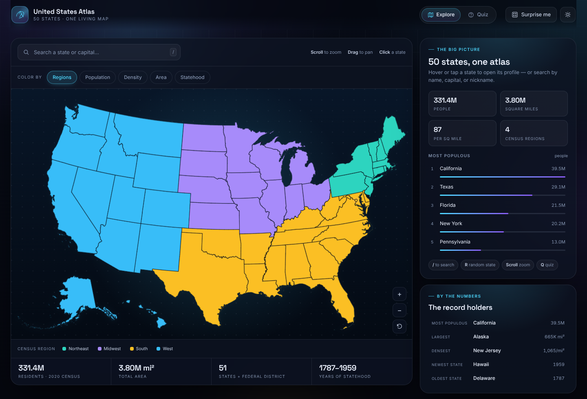
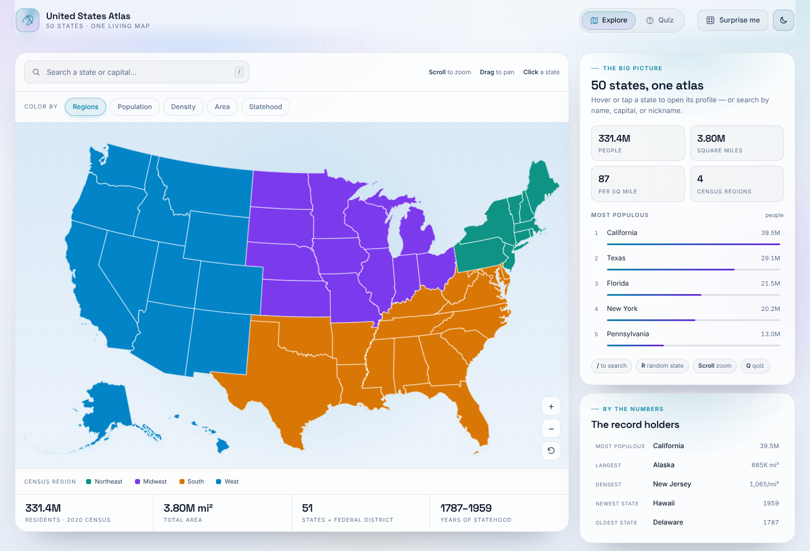
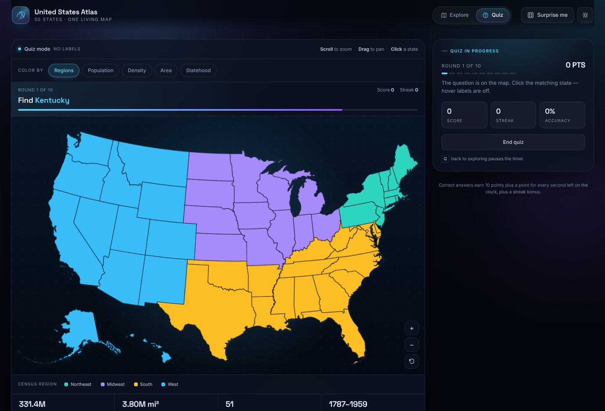
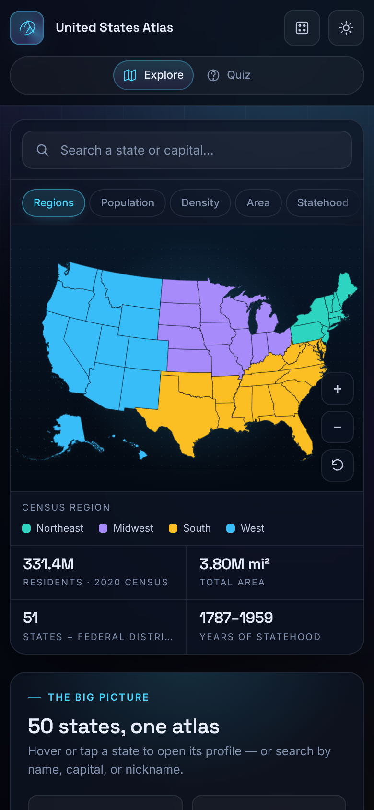

# United States Atlas

An animated, fully interactive map of the United States. Explore all 50 states plus the
District of Columbia, compare them across five data views, and test your geography with a
timed quiz.

Built as a dependency-light Vite app with D3 for the projection, zooming, and color scales.



## Screenshots

| Explore | Light theme |
| --- | --- |
|  |  |

| Timed quiz | Mobile |
| --- | --- |
|  |  |

## Quick start

```bash
npm install
npm run dev      # http://localhost:5173
npm run build    # production bundle in dist/
npm run preview  # preview the production build
```

Requires Node 18 or newer.

## What it does

### Explore
- **Animated map** — every state draws in on load, staggered by admission order, and
  color changes ease between views.
- **Hover tooltips** with the state name, capital, and the current metric.
- **Click a state** for a profile: capital, largest city, population, area, density,
  statehood date, nickname, a notable fact, population and area rank, and a "Did you know?"
  card. A "More in the region" list lets you hop between neighbors.
- **Search** by state name, abbreviation, capital, or nickname. Arrow keys and `Enter`
  work; the map flies to the result.
- **Five color modes** — Census regions, population, density, total area, and year of
  statehood — each with a live legend and a matching top-five leaderboard.
- **Zoom and pan** with the wheel, drag, on-screen controls, or `+` / `−`; double-click
  zoom is disabled so clicks stay predictable. Abbreviations fade in once you zoom past
  ~1.2×.
- **Deep links** — every profile has a URL such as `/#tx` or `/#ca`, so a state can be
  shared or bookmarked.
- **Light and dark themes**, remembered on your device.
- **National overview** — population, total area, density, region breakdown, and record
  holders (most populous, largest, densest, newest, oldest).
- **Responsive layout** that turns into a single column with a compact map on phones.
- **Keyboard shortcuts** — `/` search, `R` random state, `Q` toggle quiz, `0` reset zoom,
  `+` / `−` zoom, `←` / `→` step through states, `Esc` close or clear.

### Quiz
- **Two modes**: *Find the state* (the name is given) and *Capital match* (locate the
  state from its capital).
- **10 rounds, 12 seconds each**, with a live timer, score, streak, accuracy, and round
  progress.
- **Scoring**: 10 points per correct answer, plus 1 point for each second left on the
  clock, plus a 2-point bonus for every consecutive hit.
- Hover labels are hidden during the quiz so the map stays fair.
- Correct states flash green; a wrong guess is outlined in red while the correct state is
  revealed with the answer.
- **Results screen** with a grade, accuracy, best streak, missed states, and personal bests
  per mode saved locally.

## Data

| Data | Source |
| --- | --- |
| Population | 2020 U.S. Census |
| Area | Total area in square miles |
| Statehood dates | Dates of ratification or admission |
| Boundaries | U.S. Census Bureau Cartographic Boundary Files, via [`us-atlas`](https://github.com/topojson/us-atlas) (1:10m) |

The District of Columbia is included in Explore but is not part of the 50-state dataset:
it has a federal-district status rather than a statehood date, is drawn as a distinct marker,
and is excluded from the quiz and from state-level superlatives.

## Stack

- [Vite](https://vite.dev/) for the dev server and build.
- [`d3-geo`](https://github.com/d3/d3-geo) for the Albers USA projection and path geometry.
- [`d3-zoom`](https://github.com/d3/d3-zoom) + `d3-selection` for pan, zoom, and animated
  focus transitions.
- [`topojson-client`](https://github.com/topojson/topojson-client) to unpack the boundary
  topology.
- Self-hosted [Inter](https://rsms.me/inter/) and
  [Space Grotesk](https://fonts.floriankarsten.com/space-grotesk) variable fonts.

## Project layout

```
index.html            app shell and SVG scaffolding
src/main.js           view state, sidebar, search, metrics, theme, quiz wiring
src/map.js            projection, animated states, tooltip, zoom, color scales
src/quiz.js           quiz engine (rounds, timer, scoring, persistence hooks)
src/data/states.js    state facts and metric definitions
src/style.css         themes, layout, map and quiz styling
```

## Accessibility

State paths are focusable buttons with labels, keyboard selection works on the map, the
search combobox supports arrow keys and `Enter`, status messages are announced with
`aria-live`, focus rings are visible, and all animations respect
`prefers-reduced-motion`.

## License

MIT — see [LICENSE](LICENSE).
